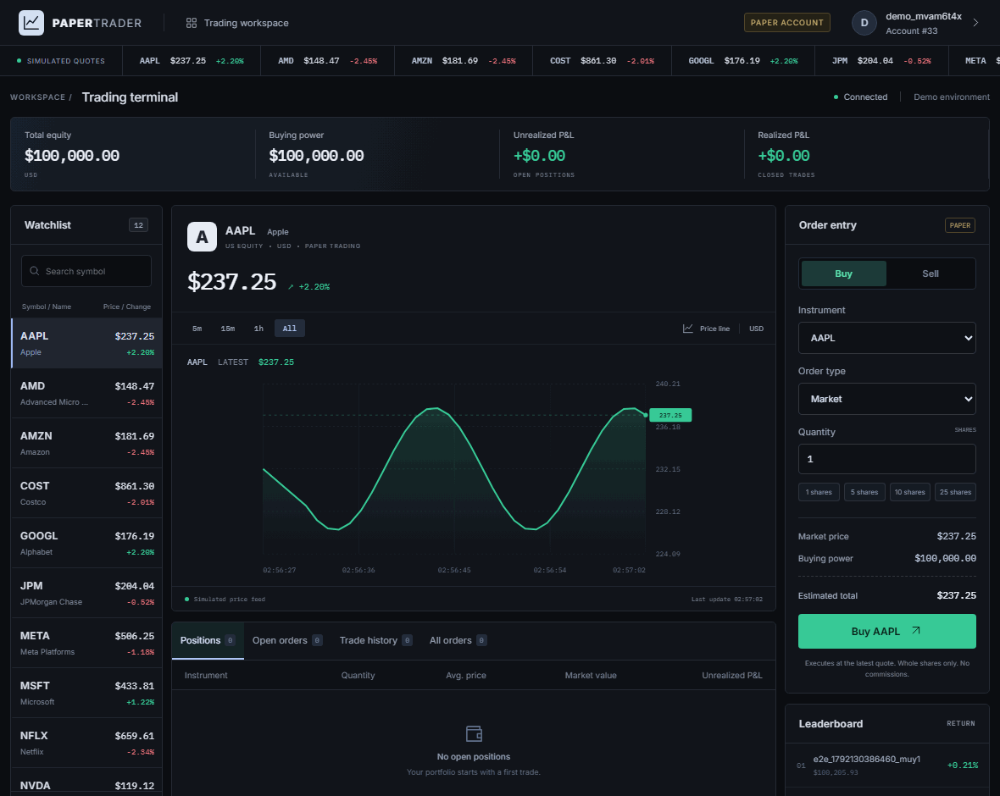
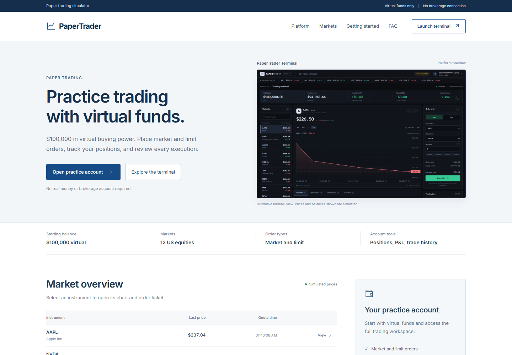
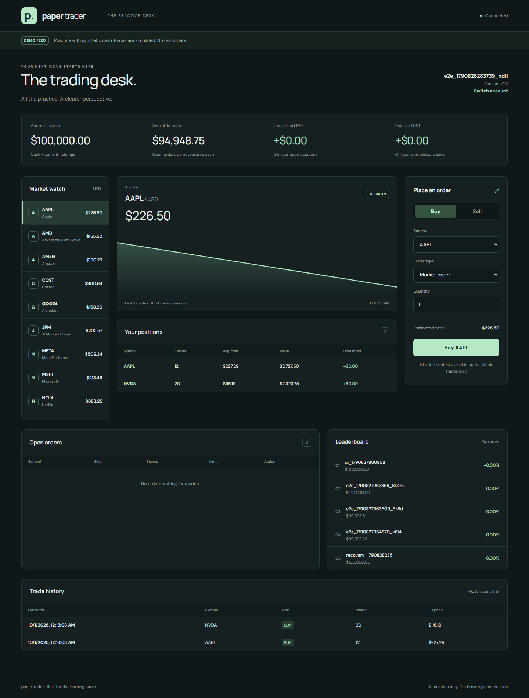
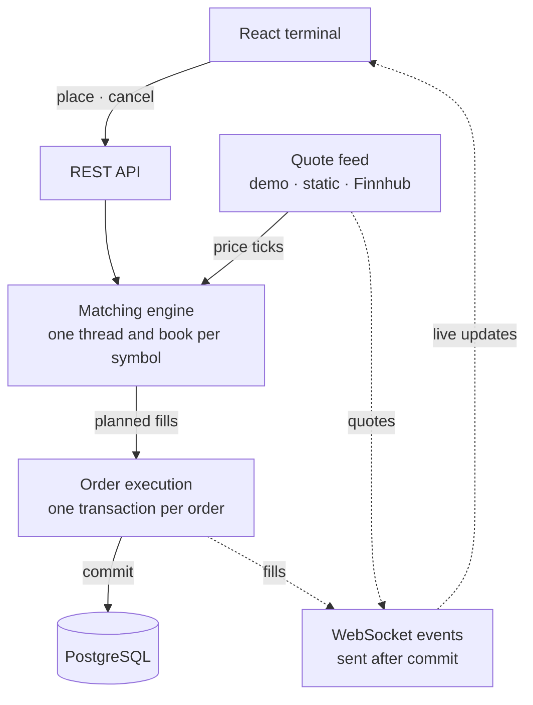
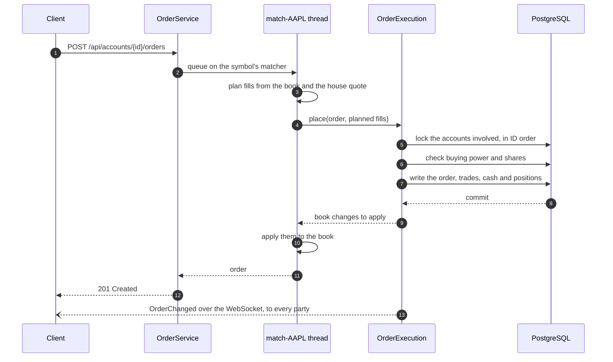
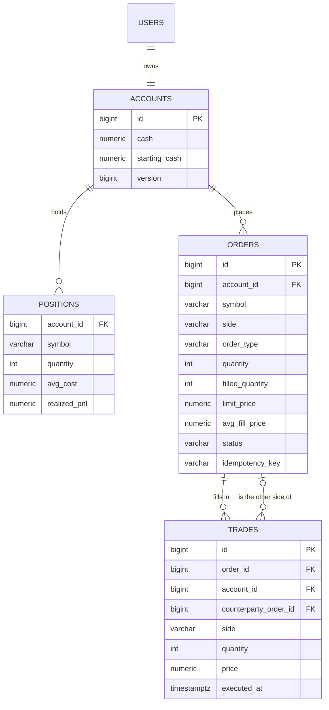

<div align="center">

# PaperTrader

**A paper-trading simulator with a real matching engine.**<br>
Trade against other users and a simulated market maker, watch partial fills land live, and track your P&L. No real money involved.

[](https://github.com/nishantshah0/paper-trader/actions/workflows/ci.yml)
[](LICENSE)


[Quick start](#quick-start) · [How matching works](#how-matching-works) · [Architecture](#architecture) · [API](#api) · [Design notes](docs/architecture.md)



<sub>A buy limit for 10 AAPL at $232.15 rests in the book until the price falls through it, then fills with no further request. Cash, P&L, positions and history update over the WebSocket.</sub>

</div>

## Highlights

- **Order book with price-time priority.** Users trade with each other first, best price then oldest. Orders fill in parts, and a partly filled order keeps its place in the queue.
- **A simulated market maker.** The house quotes a bid and an ask around the feed price, so a market order always has something to trade with, even if you're the only user.
- **One matcher thread per symbol.** Symbols match in parallel and nothing within a symbol interleaves. Postgres stays the source of truth.
- **Safe under concurrency.** Accounts are locked in ID order so trades can't deadlock, the book changes only after the transaction commits, and retries with an `Idempotency-Key` never place the same order twice.
- **A full trading terminal.** Searchable watchlist, a chart with crosshair and time ranges, an order ticket showing the house bid and ask, a live order book, P&L and a leaderboard ranked by return.
- **Live everywhere.** Fills, quotes and portfolio changes are pushed over STOMP WebSockets to every open tab, with a polling fallback.
- **Tested against the real thing.** The backend tests run on Postgres through Testcontainers, and Playwright and Cypress drive the packaged app in CI.

> [!NOTE]
> No real money or brokerage connection. The default feed generates simulated prices; an optional Finnhub mode uses real quotes. Practice accounts are unauthenticated, so this is built for local use.

## Quick start

With Docker running:

```bash
git clone https://github.com/nishantshah0/paper-trader.git
cd paper-trader
docker compose --profile app up --build -d --wait
```

Open **http://localhost:8080**, choose **Open practice account**, pick a lowercase name and you start with **$100,000** in virtual cash. Keep the account ID to reopen the account later. The terminal is at **http://localhost:8080/terminal**.

The first build downloads Java and Node dependencies. The app and database listen on localhost only. To stop them and keep your data:

```bash
docker compose --profile app down
```

<details>
<summary><b>Screenshots</b></summary>
<br>





</details>

## How matching works

Each symbol has two sources of liquidity:

| Source           | Prices                                                                                                    | Size                  |
| ---------------- | --------------------------------------------------------------------------------------------------------- | --------------------- |
| **Other users**  | Their resting limit orders                                                                                | What they posted      |
| **The house**    | A bid and an ask either side of the feed price, 10 basis points apart by default (`HOUSE_SPREAD_BPS`)     | Unlimited             |

An incoming order:

1. Trades with resting user orders, best price first and oldest first within a price, at each resting order's limit.
2. Stops at its own limit, or at any level where the house offers a better price. At an equal price the user goes first.
3. Trades whatever is left with the house, if the house price is within its limit.
4. If shares are still left, a limit order **rests in the book, partly filled**. A market order always fills completely.

Users meet inside the spread; an order priced through the house trades with the house. When the feed moves, resting orders the new house quote crosses fill in full at the house price. An order that would trade with the same account's resting order is refused.

<details>
<summary><b>Worked example</b></summary>
<br>

The feed is at 50.00 with a 1% spread, so the house bids **49.75** and asks **50.25**.

| Step | Order                                 | Fills                                                     | Result                                        |
| ---- | ------------------------------------- | --------------------------------------------------------- | --------------------------------------------- |
| 1    | Alice (holds 10): sell limit 10 @ 50.10 | None yet                                                | Rests in the book, beating the house ask      |
| 2    | Bob: market buy 4                     | 4 @ 50.10 from Alice                                      | Alice's sell is 4/10 filled                   |
| 3    | Bob: market buy 8                     | 6 @ 50.10 from Alice, then 2 @ 50.25 from the house       | Alice is filled; Bob's average is 50.1375     |

This is the `usersInsideTheSpreadTradeWithEachOtherAndTheRestGoesToTheHouse` integration test.

</details>

**Reservations.** Open limit orders reserve what they still need: a buy holds its limit price times its remaining shares, and a sell holds its remaining shares. New orders can only use buying power and shares that aren't already reserved, so a resting order stays funded until it fills or is cancelled. Cancelling a partly filled order keeps what already filled.

**Simplifications.** Fills are whole-share and long-only, with no commissions, shorting, or slippage beyond the house spread.

## Architecture

### System overview



- **One matcher per symbol.** A single thread owns each symbol's book and runs every placement, cancel and quote-driven fill for it in turn. Symbols match in parallel, and nothing within a symbol interleaves.
- **Postgres is the record.** The in-memory book is only an index of open orders. It's rebuilt from the `orders` table on startup, and reloaded if the book and the database ever disagree.
- **Events after commit.** Account updates go out over the WebSocket only once the transaction commits, so a client never sees a fill that was rolled back.

### Life of an order



The request thread holds no database connection while it waits for the matcher, and gives up with a 503 after 10 seconds, so a busy symbol can't drain the connection pool. If anything fails before the commit, the book is untouched and the client gets a problem response.

### Concurrency and correctness

| Problem                                            | How it's handled                                                                                                   |
| -------------------------------------------------- | ------------------------------------------------------------------------------------------------------------------ |
| Two orders on one symbol racing for the same shares | They're queued on that symbol's matcher thread, so they run one after the other.                                    |
| Two users trading on two symbols at once           | Both transactions lock the same pair of accounts, always lowest ID first, so neither can hold what the other needs. |
| A transaction that rolls back                      | Fills are only planned in memory. The book changes after the commit, so a failure leaves nothing to undo.           |
| The book drifting from the database                | Each fill checks the order's row. On a mismatch the symbol's book is reloaded and the order retried once.           |
| Spending the same cash twice                       | Open orders reserve the cash or shares they still need, and every order is checked against what's left.            |
| A client retrying a request                        | The same `Idempotency-Key` and payload returns the original order. A different payload gets a 409.                 |
| A stale price feed                                 | The house stops trading until a fresh quote arrives. Market orders are refused; limit orders wait.                  |

### Data model



The schema is managed by Flyway, and Hibernate only validates it. Check constraints in the database back up the rules in the code: cash and positions can't go negative, an order can't fill more than its quantity, and only a fully filled order can be `FILLED`. A trade with no `counterparty_order_id` was against the house.

### Repository layout

```text
src/main/java/.../papertrader/
├── account/      accounts and users
├── portfolio/    portfolio valuation, P&L and the leaderboard
├── quote/        price feed, quote cache and history
├── trading/      order book, matching engine, order execution, positions
└── web/          WebSocket config, events and error handling
src/main/resources/db/migration/   Flyway migrations, V1 to V4
frontend/src/                      React home page and trading terminal
frontend/tests/                    Playwright browser and WebSocket tests
frontend/cypress/                  Cypress buying-power tests
docs/architecture.md               design notes and tradeoffs
```

More on the threading model, the race handling and the tradeoffs is in [docs/architecture.md](docs/architecture.md).

### Tech stack

| Layer    | Tools                                                                       |
| -------- | --------------------------------------------------------------------------- |
| Backend  | Java 21, Spring Boot 4.1, Spring Data JPA, Flyway, STOMP WebSockets          |
| Database | PostgreSQL 17                                                               |
| Frontend | React 19, Vite 7, STOMP.js                                                  |
| Testing  | JUnit, Testcontainers, Mockito, Playwright, Cypress                        |
| Delivery | Docker Compose, GitHub Actions                                              |

## Quote modes

| Mode             | Behavior                                                       |
| ---------------- | -------------------------------------------------------------- |
| `demo` (default) | Simulated price updates every 15 seconds, labeled in the UI.   |
| `static`         | Configured prices never change, for deterministic experiments. |
| `finnhub`        | Real provider quotes, fetched server-side. Needs your own key. |

<details>
<summary><b>Using Finnhub</b></summary>
<br>

Copy `.env.example` to `.env` and set:

```dotenv
FEED_MODE=finnhub
FINNHUB_API_KEY=your_key
FEED_INTERVAL_MS=15000
```

Then rerun the Quick start Compose command. The key stays on the server. The adapter calls [Finnhub's quote endpoint](https://finnhub.io/docs/api/quote); twelve symbols at the default interval use up to 48 requests a minute, so set the interval to fit your plan.

Live mode never executes against seed prices, and a quote must be under 120 seconds old to trade on. When the feed is stale, including outside market hours, the house stops trading: market orders are refused and limit orders rest until a fresh quote crosses them. Users can still trade with each other. The tests never contact Finnhub.

</details>

## Development

You'll need **JDK 21**, **Node 22** and Docker. Maven comes with the wrapper, and `.nvmrc` pins the Node version.

```bash
# Backend (Spring Boot starts the Compose database for you)
./mvnw spring-boot:run

# Frontend, in another terminal
cd frontend
npm ci
npm run dev
```

On Windows, use `.\mvnw.cmd`. Vite proxies REST and WebSocket traffic to port 8080. Stop the packaged app container before running the backend locally.

### Running the tests

```bash
./mvnw verify                          # backend, against real Postgres
cd frontend
npm ci
npm run format:check
npm run build
npx playwright install chromium
npm test                               # browser tests, against the running app
```

Browser tests expect the full app at `http://127.0.0.1:8080`; set `E2E_BASE_URL` to point them elsewhere. They create throwaway accounts, so use a disposable database if you care about a clean practice environment.

The tests cover user-to-user and partial fills, price-time and house priority, self-trade refusal, concurrent trades between the same accounts on two symbols, scheduled limit fills, double-spend and fill/cancel races, idempotent retries, stale quotes, migrations, P&L, navigation, account persistence, responsive layouts, and WebSocket delivery across two tabs. CI runs on every pull request and on main.

## API

All bodies are JSON and errors are [RFC 9457](https://www.rfc-editor.org/rfc/rfc9457) problem details. Cash has two decimal places; prices and average costs use four decimal places. Everything is USD.

| Method | Path                                    | Purpose                                    |
| ------ | --------------------------------------- | ------------------------------------------ |
| POST   | `/api/accounts`                         | Create a practice account                  |
| GET    | `/api/accounts/{id}`                    | Cash and starting balance                  |
| GET    | `/api/accounts/{id}/portfolio`          | Positions, value and P&L                   |
| POST   | `/api/accounts/{id}/orders`             | Place an order (optional `Idempotency-Key`) |
| GET    | `/api/accounts/{id}/orders?status=OPEN` | List orders; `status` is optional          |
| GET    | `/api/accounts/{id}/orders/{orderId}`   | One order                                  |
| DELETE | `/api/accounts/{id}/orders/{orderId}`   | Cancel an open order                       |
| GET    | `/api/accounts/{id}/trades`             | Fills, newest first                        |
| GET    | `/api/book/{symbol}`                    | Top 10 price levels and the house quote    |
| GET    | `/api/quotes`, `/api/quotes/{symbol}`   | Cached quotes and timestamps               |
| GET    | `/api/quotes/status`                    | Feed mode                                  |
| GET    | `/api/quotes/history`                   | Up to 240 recent quotes per symbol         |
| GET    | `/api/leaderboard`                      | Top 20 by return percentage                |
| GET    | `/actuator/health`                      | Health check                               |

<details>
<summary><b>Example: place a limit order</b></summary>
<br>

```bash
curl -X POST http://localhost:8080/api/accounts/1/orders \
  -H 'Content-Type: application/json' \
  -H 'Idempotency-Key: 6f1c2a' \
  -d '{"symbol":"AAPL","side":"BUY","type":"LIMIT","quantity":2,"limitPrice":225.50}'
```

Leave out `type` and `limitPrice` for a market order.

</details>

**WebSockets.** Connect to the STOMP endpoint at `/ws` and subscribe to `/topic/quotes` and `/topic/accounts/{id}`. Account events fire after commit and tell the client to refresh its portfolio, orders and trades. Browsers can't publish to the broker.

## Limitations

- **No authentication.** Account IDs aren't passwords. Add identity and authorization before deploying publicly.
- **Small-scale by design.** The leaderboard scans every account and order lists aren't paginated.
- **Out of scope.** Corporate actions, exchange calendars, persistent price history and distributed messaging.

## What I'd do next

- **A finite house.** Give the market maker a displayed size per tick, so large orders walk the book and the spread moves with demand.
- **More order types.** Stop orders, time-in-force (IOC, FOK, day) and amend-in-place.
- **Persist quote history.** Chart history lives in memory and resets on restart.
- **Authentication**, so it can be hosted publicly.

## Contributing

See [CONTRIBUTING.md](CONTRIBUTING.md) for setup, checks and guidelines. Please use the issue forms for bugs and feature requests.

## License

[MIT](LICENSE)
